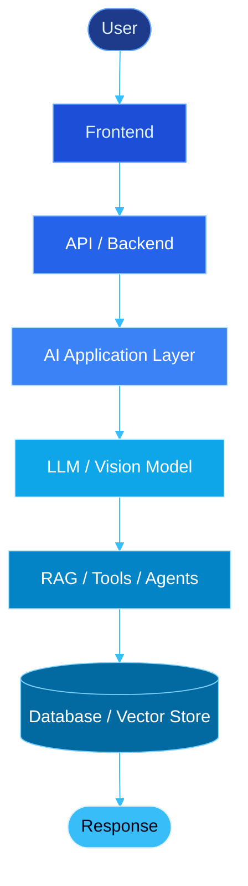
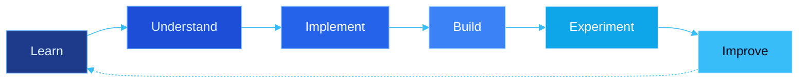

```mermaid
%%{init: {'theme':'base','themeVariables':{'primaryColor':'#0B1B4D','primaryTextColor':'#E0F2FE','primaryBorderColor':'#38BDF8','lineColor':'#38BDF8','fontFamily':'monospace'}}}%%
flowchart LR
    A[Problem] --> B[Architecture] --> C[AI Model] --> D[Backend] --> E[Data] --> F[Frontend] --> G[Deployment]
    style A fill:#1E3A8A,stroke:#60A5FA,color:#E0F2FE
    style B fill:#1D4ED8,stroke:#60A5FA,color:#E0F2FE
    style C fill:#2563EB,stroke:#93C5FD,color:#fff
    style D fill:#3B82F6,stroke:#BAE6FD,color:#fff
    style E fill:#0EA5E9,stroke:#E0F2FE,color:#fff
    style F fill:#0284C7,stroke:#BAE6FD,color:#fff
    style G fill:#38BDF8,stroke:#E0F2FE,color:#020617
```

<!-- ============================================================
     Muhammad Daniyal | AI Engineer | Computer Vision & AI Apps
     Theme: Deep-space blue / neural cyan  |  No hyperlinks used
     Only ONE edit needed: replace  yourusername  in the profile-views counter at the bottom
     ============================================================ -->

<!-- ═══════════════════════ HERO ═══════════════════════ -->

 

<!-- ═══════════════════════ ABOUT ═══════════════════════ -->

I'm an **AI Engineer** focused on building practical AI applications by combining **Computer Vision, Deep Learning, LLMs, RAG, and modern AI architectures**.

I enjoy taking an idea from **concept → AI model → backend → frontend → working product**.

My current direction is **Computer Vision + AI Applications**, where I explore real-time visual systems, multimodal AI, intelligent agents, and AI-powered web/mobile applications.

> 💡 *Understand deeply. Build deliberately. Turn ideas into intelligent systems.*

 

| | |
|:--|:--|
| 🎯 **Current Focus** | Computer Vision • Deep Learning • LLM Applications • Multimodal AI |
| 👁️ **CV Focus** | OpenCV • MediaPipe • YOLO • OCR • Object Detection • Image Processing |
| 🧠 **AI Focus** | RAG • LLMs • AI Agents • MCP • Semantic Search • Embeddings |
| 🏗️ **Engineering Focus** | FastAPI • React • React Native • AI-powered applications |
| 🔬 **Learning Approach** | Theory → Implementation → Projects → Real-world Systems |
| 🚀 **Goal** | Build intelligent, real-time and production-oriented AI applications |

<!-- ═══════════════════════ TECH ARSENAL ═══════════════════════ -->

<h3 align="center">🧠 AI &amp; LLM Stack</h3>

  
  
  
  
  
  

<h3 align="center">👁️ Computer Vision &amp; Deep Learning</h3>

  

  
  
  

  
  
  
  
  
  
  

<h3 align="center">🔍 RAG &amp; Vector Databases</h3>

  
  
  
  
  
  

<h3 align="center">🤖 AI Agents &amp; Architecture</h3>

  
  
  
  
  
  

<h3 align="center">💻 Programming Languages</h3>

  

<h3 align="center">🌐 Full-Stack Development</h3>

  

  

<h3 align="center">🗄️ Databases &amp; Storage</h3>

  

  
  

<h3 align="center">🔧 Development &amp; Deployment</h3>

  

  
  
  
  
  
  
  

<h3 align="center">🎨 AI Tooling &amp; Platforms</h3>

  
  
  
  
  

<h3 align="center">🎬 Creative &amp; Productivity Tools</h3>

  
  
  
  

<!-- ═══════════════════════ CORE COMPETENCIES ═══════════════════════ -->

| Domain | What I Build |
|:--|:--|
| 👁️ **Computer Vision** | Real-time vision applications using OpenCV, MediaPipe, YOLO and deep learning |
| 🧠 **Deep Learning** | Neural networks, CNNs, transfer learning and model-based AI applications |
| 🔎 **RAG Systems** | Retrieval pipelines using embeddings, vector databases and semantic search |
| 🤖 **AI Agents** | Tool-using AI agents with LangGraph, LangChain and MCP |
| 🧩 **LLM Applications** | AI applications using modern LLM APIs, prompting and structured workflows |
| 🌐 **Full-Stack AI** | AI-powered web and mobile applications with modern frontend/backend stacks |
| 🔗 **AI Integration** | Connecting AI models with APIs, databases, tools and real-world applications |
| 📱 **AI + Mobile** | Exploring AI-powered mobile experiences with React Native |
| ⚡ **Real-Time AI** | Camera-based and interactive AI systems with real-time inference |

<!-- ═══════════════════════ CV JOURNEY ═══════════════════════ -->

<h3 align="center">🔬 Areas I'm Exploring</h3>

| | | |
|:--:|:--:|:--:|
| 🖼️ **Image Processing & CV Fundamentals** | 🎯 **Object Detection & Tracking** | ✋ **Hand Tracking & Gesture Recognition** |
| 🧍 **Human Pose Estimation** | 🙂 **Face Detection & Recognition** | 📝 **OCR & Document Vision** |
| 🎥 **Real-Time Video Processing** | 🧩 **Image Segmentation** | 🧠 **Vision Transformers** |
| 🔗 **Vision-Language Models** | 🤖 **Multimodal AI** | ⚡ **Real-Time & Edge Vision Systems** |

<!-- ═══════════════════════ AI ENGINEERING FOCUS ═══════════════════════ -->

<table align="center">
<tr>
<td width="50%" valign="top">

### 🔍 Retrieval-Augmented Generation
- Document processing & chunking
- Embeddings & vector search
- Semantic retrieval
- Hybrid retrieval
- Context optimization
- RAG evaluation
- Domain-specific knowledge systems

</td>
<td width="50%" valign="top">

### 🤖 Agentic AI
- AI agents
- Tool calling
- Agent workflows
- LangGraph
- LangChain
- MCP
- Memory & context
- Multi-step AI workflows

</td>
</tr>
</table>

<h3 align="center">🏗️ AI Application Engineering</h3>

<!-- ═══════════════════════ CURRENT PROJECTS ═══════════════════════ -->

| Project Type | Focus Area |
|:--|:--|
| 👁️ **Computer Vision** | Real-time visual AI applications |
| 🤖 **AI Agents** | Tool-using and workflow-based intelligent systems |
| 🔎 **RAG Systems** | Domain-specific knowledge and retrieval systems |
| 🧠 **Deep Learning** | Practical model implementation and experimentation |
| 🌐 **AI Web Apps** | Full-stack applications with integrated AI |
| 📱 **AI Mobile Apps** | AI-powered experiences with React Native |
| 🔗 **Multimodal AI** | Combining vision, language and AI capabilities |
| ⚡ **Real-Time AI** | Interactive camera and vision-based systems |

<!-- ═══════════════════════ CONTINUOUS LEARNING ═══════════════════════ -->

<em>Currently deepening my knowledge in:</em>

 

 

 

<!-- ═══════════════════════ WHAT MAKES ME DIFFERENT ═══════════════════════ -->

<table align="center">
<tr>
<td align="center" width="33%" valign="top">

### 🧠 Deliberate AI Engineering

I don't just use AI — I focus on understanding the concepts behind the tools, models, and architectures I build with.

</td>
<td align="center" width="33%" valign="top">

### 🏗️ System-First Thinking

I like looking at the complete system, from the problem to the architecture, AI model, backend, data, frontend and deployment.

</td>
<td align="center" width="33%" valign="top">

### 🌍 Full-Stack AI

My goal is not only to build AI models, but to integrate them into usable applications through modern web, mobile, backend, database and deployment technologies.

</td>
</tr>
</table>

 

<!-- ═══════════════════════ CURRENT DIRECTION ═══════════════════════ -->

  
  
  
  
   
  
  
  

 

<!-- ═══════════════════════ BUILDING WITH PURPOSE ═══════════════════════ -->

<em>💡 Turning ideas into intelligent, real-world applications.</em>

  Built with ❤️ and a deliberate approach to AI engineering.

