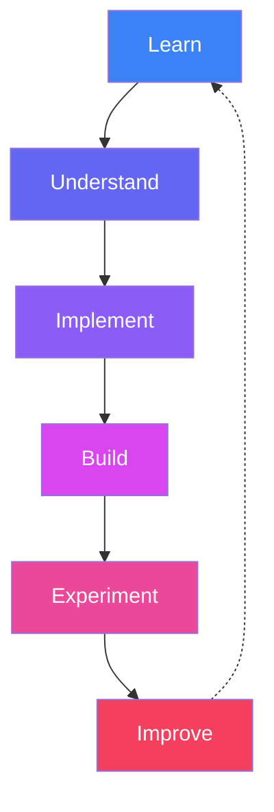
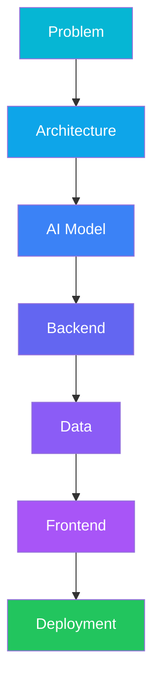

<!-- ============================================================
     ⚡ Muhammad Daniyal — AI Engineer | Computer Vision
     HOW TO USE:
     1. Replace every  yourusername  with your GitHub username
     2. Replace the placeholder links (LinkedIn, email, etc.)
     3. Paste into your profile repo: github.com/yourusername/yourusername/README.md
     ============================================================ -->

<!-- ░░░░░░░░░░░░░░░░░░░░░ HERO BANNER ░░░░░░░░░░░░░░░░░░░░░ -->

 

  

 

 

<!-- ░░░░░░░░░░░░░░░░░░░░░ ABOUT ░░░░░░░░░░░░░░░░░░░░░ -->
<h2 align="center">🧠 &nbsp;About Me</h2>

 

I'm an **AI Engineer** who builds practical AI applications by combining **Computer Vision, Deep Learning, LLMs, RAG, and modern AI architectures**.
I love taking an idea from **concept → AI model → backend → frontend → a working product** — and my current direction is **Computer Vision + AI Applications**: real-time visual systems, multimodal AI, intelligent agents, and AI-powered web/mobile apps.

> 💡 *Understand deeply. Build deliberately. Turn ideas into intelligent systems.*

| 🎯 Focus | Details |
|:--|:--|
| 🎯 **Current Focus** | Computer Vision • Deep Learning • LLM Applications • Multimodal AI |
| 👁️ **CV Focus** | OpenCV • MediaPipe • YOLO • OCR • Object Detection • Image Processing |
| 🧠 **AI Focus** | RAG • LLMs • AI Agents • MCP • Semantic Search • Embeddings |
| 🏗️ **Engineering** | FastAPI • React • React Native • AI-powered applications |
| 🔬 **Learning Approach** | Theory → Implementation → Projects → Real-world Systems |
| 🚀 **Goal** | Build intelligent, real-time, production-oriented AI applications |

<!-- ░░░░░░░░░░░░░░░░░░░░░ TECH ARSENAL ░░░░░░░░░░░░░░░░░░░░░ -->
<h2 align="center">🛠️ &nbsp;Technical Arsenal</h2>

<h3 align="center">💻 Languages</h3>

  

<h3 align="center">👁️ Computer Vision & Deep Learning</h3>

  
    
  
  
  
  

  Image Processing • Object Detection • Image Classification • Segmentation • OCR • Face & Hand Tracking • Pose Estimation

<h3 align="center">🧠 AI & LLM Stack</h3>

  
  
  
  
  
  

<h3 align="center">🔍 RAG & Vector Databases</h3>

  
  
  
  
  

<h3 align="center">🤖 AI Agents & Architecture</h3>

  
  
  
  

<h3 align="center">🌐 Full-Stack Development</h3>

  

  

<h3 align="center">🗄️ Databases</h3>

  

<h3 align="center">🔧 Dev, Deployment & Tools</h3>

  
    
  
  
  
  
  
  
  

<h3 align="center">🎨 AI Tooling & Creative</h3>

  
  
  
  
  
  
  
  
  

<!-- ░░░░░░░░░░░░░░░░░░░░░ CORE COMPETENCIES ░░░░░░░░░░░░░░░░░░░░░ -->
<h2 align="center">🚀 &nbsp;Core Competencies</h2>

| Domain | What I Build |
|:--|:--|
| 👁️ **Computer Vision** | Real-time vision apps using OpenCV, MediaPipe, YOLO and deep learning |
| 🧠 **Deep Learning** | Neural networks, CNNs, transfer learning and model-based AI apps |
| 🔎 **RAG Systems** | Retrieval pipelines with embeddings, vector databases and semantic search |
| 🤖 **AI Agents** | Tool-using agents with LangGraph, LangChain and MCP |
| 🧩 **LLM Applications** | Apps built on modern LLM APIs, prompting and structured workflows |
| 🌐 **Full-Stack AI** | AI-powered web and mobile apps with modern frontend/backend stacks |
| 🔗 **AI Integration** | Connecting models with APIs, databases, tools and real-world apps |
| 📱 **AI + Mobile** | AI-powered mobile experiences with React Native |
| ⚡ **Real-Time AI** | Camera-based, interactive AI systems with real-time inference |

<!-- ░░░░░░░░░░░░░░░░░░░░░ FEATURED PROJECTS ░░░░░░░░░░░░░░░░░░░░░ -->
<h2 align="center">🎬 &nbsp;Featured Projects</h2>

 

<table align="center">
<tr>
<td width="50%" valign="top">

### 👁️ VisionLens
**Final-Year Project · Real-Time Visual Translation & Understanding Assistant**

A mobile-first AI app that understands what the camera sees — **OCR, translation, tap-to-identify (YOLO), voice, and an AI chatbot with RAG**.

[🔗 View Repository](https://github.com/yourusername/visionlens)

</td>
<td width="50%" valign="top">

### 📄 Resumind AI
**AI-Powered Resume Analyzer & Builder**

A full-stack web app that analyzes resumes and helps build better ones using LLM-powered feedback.

[🔗 View Repository](https://github.com/yourusername/resumind-ai)

</td>
</tr>
<tr>
<td width="50%" valign="top">

### ✋ Hand Tracking & Gesture Control
**Computer Vision Experiment**

Real-time hand landmark detection and gesture recognition with **MediaPipe + OpenCV**.

[🔗 View Repository](https://github.com/yourusername/your-repo)

</td>
<td width="50%" valign="top">

### 🔎 RAG Knowledge Assistant
**Domain-Specific Retrieval System**

Document chunking, embeddings, vector search and context-optimized answers.

[🔗 View Repository](https://github.com/yourusername/your-repo)

</td>
</tr>
</table>

✏️ Edit the titles and repo links above to match your real projects — copy any <code>&lt;td&gt;</code> block to add more.

<!-- ░░░░░░░░░░░░░░░░░░░░░ CV JOURNEY ░░░░░░░░░░░░░░░░░░░░░ -->
<h2 align="center">👁️ &nbsp;Computer Vision Journey</h2>

| 🖼️ Image Processing | 🎯 Detection & Tracking | ✋ Gesture Recognition |
|:--:|:--:|:--:|
| Fundamentals of CV | Objects in real time | Hand tracking |

| 🧍 Pose Estimation | 🙂 Face Detection | 📝 OCR & Document Vision |
|:--:|:--:|:--:|
| Human body keypoints | Detection & recognition | Reading text from images |

| 🎥 Real-Time Video | 🧩 Segmentation | 🧠 Vision Transformers |
|:--:|:--:|:--:|
| Live stream processing | Pixel-level understanding | Modern CV architectures |

| 🔗 Vision-Language Models | 🤖 Multimodal AI | ⚡ Edge Vision |
|:--:|:--:|:--:|
| Seeing + understanding | Vision + language + AI | Fast, on-device systems |

```mermaid
flowchart LR
    A([👤 User]) --> B[🖥️ Frontend]
    B --> C[⚙️ API / Backend]
    C --> D[🧩 AI Application Layer]
    D --> E[👁️ LLM / Vision Model]
    E --> F[🔎 RAG · Tools · Agents]
    F --> G[(🗄️ Database / Vector Store)]
    G --> H([✅ Response])

    style A fill:#3B82F6,stroke:#1E40AF,color:#fff
    style B fill:#8B5CF6,stroke:#5B21B6,color:#fff
    style C fill:#EC4899,stroke:#9D174D,color:#fff
    style D fill:#F59E0B,stroke:#B45309,color:#000
    style E fill:#10B981,stroke:#065F46,color:#fff
    style F fill:#06B6D4,stroke:#155E75,color:#fff
    style G fill:#EF4444,stroke:#991B1B,color:#fff
    style H fill:#22C55E,stroke:#166534,color:#fff
```

<!-- ░░░░░░░░░░░░░░░░░░░░░ ARCHITECTURE ░░░░░░░░░░░░░░░░░░░░░ -->
<h2 align="center">🏗️ &nbsp;How I Think — System-First</h2>

<table align="center">
<tr>
<td width="50%" valign="top">

#### 🔬 Theory → Practice

</td>
<td width="50%" valign="top">

#### 🌍 Idea → Deployment

</td>
</tr>
</table>

<!-- ░░░░░░░░░░░░░░░░░░░░░ AI ENGINEERING FOCUS ░░░░░░░░░░░░░░░░░░░░░ -->
<h2 align="center">🧠 &nbsp;AI Engineering Focus</h2>

<table align="center">
<tr>
<td width="50%" valign="top">

### 🔍 Retrieval-Augmented Generation
- 📄 Document processing & chunking
- 🧬 Embeddings & vector search
- 🎯 Semantic & hybrid retrieval
- 🧹 Context optimization
- 📊 RAG evaluation
- 🏛️ Domain-specific knowledge systems

</td>
<td width="50%" valign="top">

### 🤖 Agentic AI
- 🧑‍💼 AI agents & tool calling
- 🔁 Agent workflows
- 🕸️ LangGraph & LangChain
- 🧩 MCP
- 🧠 Memory & context
- 🪜 Multi-step AI workflows

</td>
</tr>
</table>

<!-- ░░░░░░░░░░░░░░░░░░░░░ GITHUB STATS ░░░░░░░░░░░░░░░░░░░░░ -->
<h2 align="center">📊 &nbsp;GitHub Analytics</h2>

 

  

<h3 align="center">🏆 Trophies</h3>

  

<!-- 🐍 OPTIONAL: Contribution Snake (animated)
     Needs a GitHub Action — see https://github.com/Platane/snk
     After setting it up, uncomment and use the image below:

  

-->

<!-- ░░░░░░░░░░░░░░░░░░░░░ LEARNING ░░░░░░░░░░░░░░░░░░░░░ -->
<h2 align="center">📚 &nbsp;Currently Deepening</h2>

 

 

 

<!-- ░░░░░░░░░░░░░░░░░░░░░ WHAT MAKES ME DIFFERENT ░░░░░░░░░░░░░░░░░░░░░ -->
<h2 align="center">💡 &nbsp;What Makes Me Different</h2>

<table align="center">
<tr>
<td align="center" width="33%">

### 🧠
**Deliberate AI Engineering**

I don't just *use* AI — I understand the concepts behind the tools, models and architectures I build with.

</td>
<td align="center" width="33%">

### 🏗️
**System-First Thinking**

I look at the complete system — from problem and architecture to data, frontend and deployment.

</td>
<td align="center" width="33%">

### 🌍
**Full-Stack AI**

I don't stop at models — I integrate them into usable web & mobile apps with real backends and deployment.

</td>
</tr>
</table>

<!-- ░░░░░░░░░░░░░░░░░░░░░ FOOTER ░░░░░░░░░░░░░░░░░░░░░ -->
<h2 align="center">🎯 &nbsp;My Current Direction</h2>

  
  
  
  
  
  
  

  <em>💡 Turning ideas into intelligent, real-world applications.</em>

  Built with ❤️ and a deliberate approach to AI engineering.

